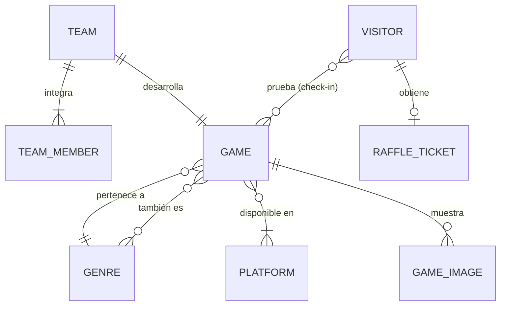
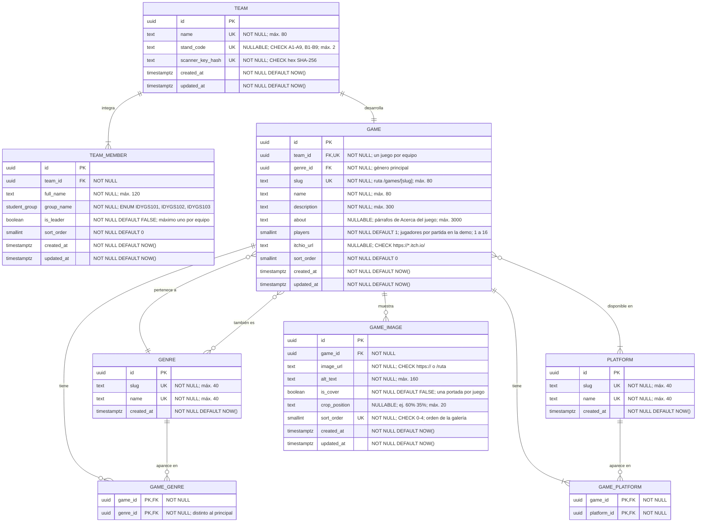
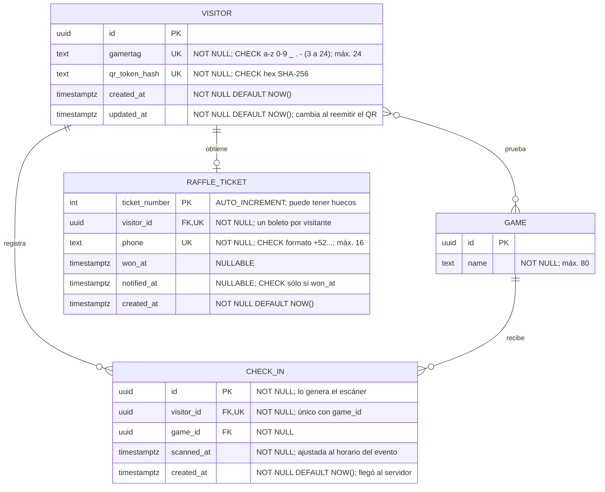

# Modelo de datos (diagrama ER)

Modelo relacional en PostgreSQL para los tres requerimientos de la plataforma:

1. **Administrar y mostrar los videojuegos** (equipos, integrantes, géneros, plataformas y fotos).
2. **Check-ins sin login**: el visitante se registra sólo con su gamertag y recibe un QR
   personal. En cada stand, el equipo escanea ese QR para registrar que probó su juego. Cuando
   probó todos los juegos, deja su teléfono y obtiene un boleto para el sorteo.
3. **Afluencia en tiempo real** de cada stand, aunque el internet del recinto falle.

Es la base para escribir `src/shared/lib/prisma/contract.prisma`. Todavía no hay modelos en el
contrato; los datos del sitio siguen siendo mock (ver [`data-sources.md`](./data-sources.md)).

Los diagramas siguen la guía de ERD de Mermaid de
[`mermaid-diagrams`](https://github.com/davila7/claude-code-templates/blob/main/cli-tool/components/skills/creative-design/mermaid-diagrams/references/erd-diagrams.md)
y el modelo se revisó con el perfil
[`database-administrator`](https://github.com/VoltAgent/awesome-claude-code-subagents/blob/main/categories/03-infrastructure/database-administrator.md)
(integridad, índices, respaldos, conexiones, seguridad y monitoreo), ajustado a un evento de
un día.

**Estado: aprobado por el equipo (2026-10-12).** Los cambios posteriores se discuten en un PR.

## Decisiones

- **Un solo evento**: no hay tabla de eventos. La fecha, la sede y el horario siguen en
  `src/features/event/lib/event-info.ts`.
- **Reglas del sorteo en el servidor**: cuándo se sortea y cuántos ganadores hay viven en el
  código del servidor, no en la base.
- **El QR es del visitante**: el equipo del stand lo escanea. El stand no tiene QR propio.
- **Sin tabla de stands**: el código del stand (`A1`...`B9`) es un campo del equipo y puede
  quedar vacío porque los equipos se registran antes de saber su stand.
- **Todos los juegos están publicados** y todos se hacen en Unity: no hay `published` ni
  `engine`. Se publican en itch.io (`itchio_url`).
- **Sin arte generado**: si un equipo no ha subido fotos, su juego no se muestra en el sitio.
  La portada es la foto con `is_cover`; sus dimensiones se validan en el servidor
  ([#62](https://github.com/ikabeee/ut-e3/issues/62)).

## Reglas de negocio

| Regla | Cómo se cumple |
| --- | --- |
| Un equipo tiene varios integrantes. | Uno a muchos: `team_member.team_id`. |
| Un equipo tiene un solo juego. | `game.team_id` es `UNIQUE` y `NOT NULL`. |
| Un equipo tiene un solo stand y un stand es de un solo equipo. | `team.stand_code` es `UNIQUE` (vacío mientras no se asigna). |
| Un juego tiene como máximo una portada y sin portada no se muestra. | `UNIQUE (game_id) WHERE is_cover` en `game_image`; las consultas del sitio filtran por portada. |
| Un juego corre en varias plataformas y una plataforma tiene muchos juegos. | Muchos a muchos con la tabla intermedia `GAME_PLATFORM`. |
| Un visitante prueba varios juegos y un juego recibe a muchos visitantes. | Muchos a muchos con la tabla intermedia `CHECK_IN`. |
| Cada juego cuenta una sola vez por visitante. | `UNIQUE (visitor_id, game_id)` en `check_in`. |
| El gamertag es único. | `UNIQUE (gamertag)` en `visitor`. |
| Un boleto por visitante, sólo si probó todos los juegos con stand asignado. | `raffle_ticket.visitor_id` es `UNIQUE`; el `INSERT` del boleto revisa los check-ins. |
| Un boleto por teléfono. | `UNIQUE (phone)` en `raffle_ticket`. |

## Modelo conceptual

Entidades y relaciones del negocio. Las relaciones muchos a muchos se dibujan directas
(`}o--o{`); en los diagramas detallados se resuelven con su tabla intermedia.



Cómo leer la cardinalidad: el símbolo junto a una entidad dice cuántas de ella corresponden a
una de la otra. `||` exactamente uno, `|o` cero o uno, `}|` uno o muchos y `}o` cero o muchos
(del lado derecho se escriben `||`, `o|`, `|{` y `o{`). Por ejemplo, `GAME }o--|| GENRE` dice
que cada juego tiene exactamente un género principal y que un género puede ser el principal de
cero o muchos juegos.

El diagrama muestra las reglas del negocio. La base de datos garantiza el lado "como máximo"
(un juego por equipo, un boleto por visitante); el lado "al menos uno" de `TEAM ||--|| GAME`,
`TEAM ||--|{ TEAM_MEMBER` y `GAME }o--|{ PLATFORM` lo valida el servidor (ver "Reglas que
valida el servidor").

## Convenciones del diagrama

- Entidades en mayúsculas y en singular (`GAME`, no `GAMES`); tablas y columnas en inglés y
  `snake_case`.
- Formato de columna: `tipo nombre llaves "restricciones"`. Las llaves son `PK`, `FK` y `UK`;
  el comentario dice siempre `NOT NULL` o `NULLABLE` y, cuando aplica, `DEFAULT`, `CHECK`,
  `ENUM` o `AUTO_INCREMENT`.
- Cuando una restricción `UNIQUE` es compuesta, el comentario lo dice (por ejemplo,
  `visitor_id` es único junto con `game_id`).
- Muchos a muchos con tabla intermedia explícita: la relación directa `}o--o{` más las dos
  relaciones uno a muchos con la tabla intermedia, cuya PK es la pareja de llaves foráneas.
  Prisma 8 tampoco acepta muchos a muchos implícitos.
- Llaves primarias `uuid` (`@default(uuid())` en Prisma 8), salvo `raffle_ticket.ticket_number`
  (autoincremental) y `check_in.id`, que **genera el escáner del stand** para poder trabajar
  sin internet.
- Toda entidad lleva `created_at`; las que se editan llevan también `updated_at`
  (`timestamptz` en UTC, `DEFAULT NOW()`).
- Los textos se guardan como `text` con un `CHECK` de longitud (`máx. N` en el diagrama). En
  PostgreSQL equivale a `varchar(n)` y Prisma 8 los recibe como `string` normal.
- Los enums (como `student_group`) son `text` con un `CHECK` de valores permitidos:
  así los genera Prisma 8 (`enum` con `@@type("pg/text@1")`). Las demás reglas simples también
  son `CHECK` (`@@check`).

## Catálogo: equipos y juegos



Notas:

- **Stand**: `stand_code` debe existir en `src/features/floor-plan/lib/plan-layouts.ts`
  (pasillos A1-A9 y B1-B9, 18 stands). Los stands informativos C1-C4 y las zonas siguen siendo
  contenido fijo del croquis. Quitar el `stand_code` de un equipo que no se presentó saca su
  juego de los requisitos del boleto sin borrar nada.
- **Escáner del stand**: cada equipo recibe una llave secreta para abrir el escáner en el
  celular de su stand; la base sólo guarda su hash (`scanner_key_hash`). Así el servidor sabe
  qué juego registra cada check-in y nadie más puede registrarlos. Si se pierde, se genera
  otra (no se puede volver a mostrar la anterior).
- **Integrantes**: `group_name` usa el enum `student_group` (`IDYGS101`, `IDYGS102`,
  `IDYGS103`). Un índice único parcial permite como máximo un líder por equipo.
- **Géneros**: el registro de videojuego (`.github/ISSUE_TEMPLATE/04-game-submission.yml`)
  permite varios. `game.genre_id` es el principal (el que agrupa el catálogo) y, como es
  `NOT NULL`, todo juego tiene exactamente uno; `GAME_GENRE` guarda los demás.
- **Plataformas**: tabla propia para que los organizadores las administren (Web, Windows,
  macOS, Linux, Android, iOS...) y relación muchos a muchos con `GAME_PLATFORM`.
- **Fotos**: todas las fotos del juego viven en `GAME_IMAGE` (máximo 5: portada y 4 capturas,
  como pide el registro).
  - `is_cover` marca la portada. Un índice único parcial impide dos portadas en el mismo juego.
  - Un juego sin portada no se muestra en el sitio.
  - `sort_order` ordena la galería. Para reordenarla, intercambia los valores dentro de una
    transacción pasando por un valor temporal, porque `UNIQUE (game_id, sort_order)` no admite
    repetidos.
  - Las dimensiones, el peso y el formato se validan en el servidor al subir la foto; las
    reglas se definen en [#62](https://github.com/ikabeee/ut-e3/issues/62).

## Participación de visitantes: check-ins y sorteo



### Flujo

1. **Registro**: el visitante entra al sitio, escribe **sólo su gamertag** y recibe su QR
   personal. El QR contiene una URL con un token aleatorio de al menos 128 bits
   (`crypto.randomBytes(16)`), `/v/<token>`; la base sólo guarda su hash (`qr_token_hash`).
   El gamertag se guarda en minúsculas para que `Neo` y `neo` sean el mismo.
2. **Check-in**: en cada stand, el equipo escanea el QR del visitante. El escáner envía los
   escaneos en lotes con su llave en un encabezado HTTP (no en la URL). El servidor obtiene el
   juego a partir de la llave y guarda todo el lote en una sola sentencia:

   ```sql
   INSERT INTO check_in (id, visitor_id, game_id, scanned_at)
   SELECT s.id, v.id, $game_id, LEAST(GREATEST(s.scanned_at, $event_start), now())
   FROM unnest($ids::uuid[], $token_hashes::text[], $scanned_at::timestamptz[])
        AS s(id, token_hash, scanned_at)
   JOIN visitor v ON v.qr_token_hash = s.token_hash
   ON CONFLICT DO NOTHING
   RETURNING id;
   ```

   - El `JOIN` descarta los QR desconocidos (mal leídos o ya reemplazados) sin abortar el
     lote; `ON CONFLICT DO NOTHING` **sin columna** ignora tanto un reenvío (mismo `id`) como
     un segundo escaneo del mismo visitante en el mismo stand.
   - Comparando los `id` devueltos con los enviados, el escáner sabe cuáles fueron nuevos,
     cuáles repetidos y cuáles desconocidos.
   - Va con SQL crudo (`db.raw.sql`): el `upsert` del ORM sólo cubre una restricción.
3. **Boleto**: cuando el visitante probó todos los juegos con stand asignado (hoy 18), su
   página le muestra un formulario para dejar su teléfono. El boleto se crea en una sola
   sentencia que se puede reintentar:

   ```sql
   INSERT INTO raffle_ticket (visitor_id, phone)
   SELECT $visitor_id, $phone
   WHERE (SELECT count(*) FROM check_in c
          JOIN game g ON g.id = c.game_id
          JOIN team t ON t.id = g.team_id
          WHERE c.visitor_id = $visitor_id AND t.stand_code IS NOT NULL)
       = (SELECT count(*) FROM game g
          JOIN team t ON t.id = g.team_id
          WHERE t.stand_code IS NOT NULL)
   ON CONFLICT (visitor_id) DO NOTHING
   RETURNING ticket_number;
   ```

   - Si no devuelve nada, el servidor busca el boleto existente (un doble toque o un
     reintento) y, si no hay, es que todavía le faltan juegos.
   - Un teléfono que ya tiene boleto lanza el error de `UNIQUE (phone)`; la app lo traduce a
     un mensaje claro.
   - `ticket_number` se muestra en pantalla. Puede tener huecos (un intento fallido consume un
     número), así que no indica cuántos boletos hay.
4. **Sorteo**: se elige entre los boletos que existen, nunca un número al azar entre 1 y el
   máximo:

   ```sql
   SELECT ticket_number FROM raffle_ticket
   WHERE won_at IS NULL
   ORDER BY random()
   LIMIT $winners;
   ```

   El servidor marca `won_at`, manda el mensaje y guarda `notified_at`. En el main stage, el
   staff escanea el QR del ganador para comprobar que el boleto es suyo: el número por sí solo
   no prueba nada.

### Identificar al visitante sin login

La página web nunca ve la dirección MAC del celular, así que su cambio por seguridad de la red
no afecta. Lo que sí se puede perder son los datos del navegador (borrar datos del sitio,
pestaña de incógnito). Por eso el QR se protege en tres capas:

1. **Cookie**: el servidor guarda el token en una cookie `httpOnly` y `Secure` de larga
   duración. No se copia a `localStorage`: borrar los datos del sitio la quita igual y
   cualquier script de la página podría leerla.
2. **Captura de pantalla**: al registrarse, la app le pide guardar una captura de su QR. El
   equipo puede escanear la captura aunque el navegador haya perdido sus datos, y al abrir el
   QR desde la galería del celular se recupera la sesión.
3. **Módulo de Información**: si pierde todo, el staff busca su gamertag y le genera un QR nuevo
   (cambia `qr_token_hash` y el anterior deja de servir). Sus check-ins no se pierden porque
   están ligados al visitante, no al token.

La página `/v/<token>` envía `Referrer-Policy: no-referrer` para que el token no se filtre a
otros sitios.

### Afluencia por stand

La afluencia no necesita otra tabla: se calcula con los check-ins recientes de cada juego.

```sql
SELECT t.stand_code, count(c.id) AS recent_check_ins
FROM game g
JOIN team t ON t.id = g.team_id
LEFT JOIN check_in c
  ON c.game_id = g.id
 AND c.scanned_at > now() - interval '15 minutes'
WHERE t.stand_code IS NOT NULL
GROUP BY t.stand_code;
```

- Usa el índice `(game_id, scanned_at)` y sólo lee los últimos 15 minutos.
- Va en una función de `lib/server/*-queries.ts` con `"use cache"` y un `cacheLife` de unos 30
  segundos, así todos los visitantes comparten una sola consulta. El croquis la pide a un
  Route Handler y la refresca con `refetchInterval` de TanStack Query.
- Qué mide: cada juego cuenta una sola vez por visitante, así que es "personas que probaron el
  juego por primera vez en los últimos 15 minutos", no la ocupación exacta del stand.

## Valores calculados

No se guardan en ninguna columna; se calculan al consultar:

| Valor | Cálculo |
| --- | --- |
| Integrantes de un equipo | `count(*)` de `team_member` |
| Juegos probados por un visitante | `count(*)` de sus `check_in` en juegos con stand |
| Juegos requeridos para el boleto | `count(*)` de `game` cuyo equipo tiene `stand_code` |
| Afluencia de un stand | check-ins de su juego en los últimos 15 minutos |

## Internet intermitente

Con el QR en el celular del visitante, lo que debe funcionar sin internet es el **escáner del
stand**:

- **Registro**: necesita internet una sola vez (para reservar el gamertag). Después, el QR es
  una imagen y funciona sin conexión.
- **Escáner**: es una página instalable (PWA) que el equipo abre antes del evento. Cada
  escaneo se guarda en una cola local (IndexedDB) con su `check_in.id` (UUID con
  `crypto.randomUUID()`) y se envía en lotes al volver la conexión.
- **Reenvíos seguros**: la sentencia del check-in es idempotente, así que el escáner conserva
  todos sus escaneos del día y tiene un botón "reenviar todo" por si hubiera que restaurar la
  base.
- **Relojes**: `scanned_at` se ajusta en SQL a `LEAST(GREATEST(hora del escáner, inicio del
  evento), now())`. Un reloj adelantado no altera la afluencia, uno atrasado no hace que se
  pierda el escaneo, y los que llegan tarde cuentan en su hora real.
- **Un solo servidor que escriba**: la base en la nube (recomendado) o un servidor local en el
  recinto que después se copia a la nube, pero no los dos a la vez: chocarían en gamertags,
  check-ins y números de boleto.

## Restricciones

### Índices

Además de las llaves primarias y las restricciones `UNIQUE` (que ya crean su índice):

| Tabla | Índice | Para qué |
| --- | --- | --- |
| `team` | `UNIQUE (stand_code)` | Un equipo por stand; buscar el equipo de un stand. |
| `team` | `UNIQUE (scanner_key_hash)` | Identificar el escáner que envía un lote. |
| `team_member` | `(team_id)` | Integrantes de un equipo. |
| `team_member` | `UNIQUE (team_id) WHERE is_leader` | Como máximo un líder por equipo. |
| `game` | `UNIQUE (team_id)` y `(genre_id)` | Juego de un equipo; juegos de un género. |
| `game_genre` | `(genre_id)` | Juegos con un género extra (la PK empieza por `game_id`). |
| `game_platform` | `(platform_id)` | Juegos de una plataforma (la PK empieza por `game_id`). |
| `game_image` | `UNIQUE (game_id, sort_order)` | Galería ordenada. |
| `game_image` | `UNIQUE (game_id) WHERE is_cover` | Una sola portada por juego. |
| `visitor` | `UNIQUE (gamertag)` y `UNIQUE (qr_token_hash)` | Buscar al visitante por gamertag o por su QR. |
| `check_in` | `UNIQUE (visitor_id, game_id)` | Un check por juego; también cuenta los del visitante. |
| `check_in` | `(game_id, scanned_at)` | Afluencia reciente por juego. |
| `raffle_ticket` | `UNIQUE (visitor_id)` y `UNIQUE (phone)` | Un boleto por visitante y por teléfono. |

Las tablas del catálogo tienen menos de 100 filas, así que sus índices de llaves foráneas casi
no se usan; se dejan para seguir una sola regla: toda llave foránea lleva índice.

### CHECK

| Tabla | Restricción |
| --- | --- |
| `team` | `stand_code ~ '^[AB][1-9]$'` y `scanner_key_hash ~ '^[0-9a-f]{64}$'` |
| `game` | `itchio_url ~ '^https://[a-z0-9-]+[.]itch[.]io/'` y `players BETWEEN 1 AND 16` |
| `game`, `genre`, `platform` | `slug ~ '^[a-z0-9]+(-[a-z0-9]+)*$'` |
| Columnas de texto | `char_length(<columna>) <= N` (el `máx. N` del diagrama) |
| `game_image` | `image_url ~ '^(https://\|/[^/])'` (URL https o ruta del sitio) y `sort_order BETWEEN 0 AND 4` |
| `visitor` | `gamertag ~ '^[a-z0-9_.-]{3,24}$'` y `qr_token_hash ~ '^[0-9a-f]{64}$'` |
| `check_in` | `scanned_at <= created_at` |
| `raffle_ticket` | `phone ~ '^[+][1-9][0-9]{7,14}$'` y `notified_at IS NULL OR won_at IS NOT NULL` |

- El gamertag sólo acepta letras sin acento en minúsculas, números, `_`, `.` y `-` (de 3 a
  24). Así no hay dos gamertags que se vean iguales con letras de otros alfabetos.
- `scanned_at <= created_at` se cumple porque las dos salen de `now()` en la misma sentencia:
  inserta check-ins sólo con la sentencia de arriba, también en los datos de prueba.

### Borrado (`onDelete`)

Decláralo explícito en cada relación del contrato:

- `Cascade`: `team` borra sus `team_member` y su `game`; `game` borra sus `game_genre`,
  `game_platform` y `game_image`; `visitor` borra su `raffle_ticket` (y con él su teléfono).
- `Restrict` (no deja borrar si hay registros que dependen): todo lo demás. Un juego con
  check-ins no se puede borrar (y por eso tampoco su equipo), ni un género o una plataforma
  con juegos.

## Reglas que valida el servidor

Se validan en las Server Actions (`lib/<feature>-actions.ts`) y en el endpoint del escáner:

- Todo equipo tiene su juego y al menos un integrante; todo juego, al menos una plataforma.
- Los géneros extra de un juego no repiten su género principal.
- El juego de un check-in sale de la llave del escáner, nunca de lo que envía el cliente.
- Las fotos cumplen las reglas de dimensiones, peso y formato
  ([#62](https://github.com/ikabeee/ut-e3/issues/62)).
- El catálogo, el detalle y el croquis sólo muestran juegos con portada.
- Los ids del lote son UUID válidos antes de llegar a la base.
- Cuándo se sortea, cuántos ganadores hay y el envío del mensaje son reglas del servidor.

## Operación el día del evento

Recomendaciones del perfil de DBA, a la medida de un evento de un día con unos 2,000
visitantes:

| Tema | Recomendación |
| --- | --- |
| Respaldos | PostgreSQL administrado con recuperación a un punto en el tiempo (PITR) y 7 días de retención (Neon, Supabase Pro o RDS; los planes gratuitos no la tienen). Pérdida máxima realista: 5 minutos; tiempo de recuperación: 15 a 45 minutos (restaurar en otra instancia y cambiar `DATABASE_URL`). `pg_dump` antes de abrir y al terminar. |
| Conexiones | El pooler del proveedor (PgBouncer en modo transacción, unas 20 conexiones) para la app y la URL directa para `db:migrate`. Pool de 1 a 3 conexiones por instancia de la app. Base en la misma región que la app y sin pausa automática ese día. |
| Roles | La app usa un rol con `SELECT`, `INSERT` y `UPDATE` (en `check_in` sólo `INSERT` y `SELECT`; `DELETE` sólo en `raffle_ticket` y el catálogo), sin permisos para cambiar tablas. Las migraciones usan otro rol. `statement_timeout = 5s` e `idle_in_transaction_session_timeout = 10s` en el rol de la app. |
| Conexión segura | `sslmode=verify-full` (o `require` como mínimo). |
| Monitoreo | Panel del proveedor y `pg_stat_statements`: conexiones (alerta arriba del 70%), CPU, las 5 consultas más costosas (el check-in y la afluencia deben quedar en menos de 10 ms), check-ins por minuto (alerta si un escáner lleva 10 minutos sin enviar en horario del evento) y un `/health` con `SELECT 1`. |
| Mantenimiento | El autovacuum por defecto basta. `VACUUM (ANALYZE)` después de cargar el catálogo y después del pico de registros. |
| Capacidad | `check_in`: máximo 36,000 filas (2,000 visitantes por 18 juegos), unos 8 MB con índices. Toda la base mide menos de 20 MB y cabe en memoria. Escrituras: 2 a 5 por segundo, con picos de 15. |
| No hace falta | Réplicas, alta disponibilidad multi-región, particiones, RLS ni auditoría. |

Antes del evento:

1. Restaurar un respaldo con PITR en otra instancia y medir cuánto tarda.
2. Prueba de carga: 300 escaneos por minuto con ráfagas de 3 veces, y 18 escáneres enviando
   500 escaneos en cola cada uno. Meta: 95% de las respuestas en menos de 300 ms y cero
   errores 5xx.
3. Simulacro sin internet: modo avión, 20 escaneos, reconectar, reenviar dos veces y un lote
   con un QR desconocido.
4. Comprobar los permisos con `SET ROLE` del rol de la app (cambiar tablas debe fallar).
5. Confirmar que hay 18 juegos con stand y revisar los `CHECK` con `\d+`.

## Relación con el tipo `Game` actual

El repositorio de Prisma de la feature `games` (`lib/server/prisma-game-repository.ts`, que
implementa `GameRepository`) arma el tipo `Game` (`src/features/games/lib/types.ts`) con estas
columnas:

| Campo de `Game` | Origen |
| --- | --- |
| `slug`, `name`, `description`, `players` | `game` |
| `about` | `game.about` partido en párrafos (línea en blanco); `null` usa el texto genérico de `games-copy.ts` |
| `genre` | `genre.name` del género principal (`game.genre_id`) |
| `team` | `team.name` |
| `members` | `count(*)` de `team_member` |
| `stand` | `team.stand_code` (vacío hasta que se asigne) |
| `image` | `game_image` con `is_cover = true` (`image_url` y `crop_position`) |

Cuando se conecte la base hay que:

- quitar `hasTournament` y `art` del tipo `Game` y de la UI, junto con el arte generado
  (`src/features/games/lib/game-art.ts`), porque ya no existen en el modelo;
- hacer `image` obligatorio, porque sólo se listan juegos con portada;
- decidir cómo se muestra un juego sin stand asignado.

## Privacidad

- El gamertag es un seudónimo; el único dato personal del visitante es el teléfono, que sólo
  se pide al final y sólo vive en `raffle_ticket`.
- El formulario del teléfono debe mostrar el aviso de privacidad y decir para qué se usa.
- Después del sorteo se borran las filas de `raffle_ticket`. Los teléfonos siguen en los
  respaldos hasta que vence su retención (7 días). `visitor` y `check_in` no tienen datos
  personales y se conservan para estadísticas.

## Por decidir

- **Proveedor de PostgreSQL** con PITR y **proveedor del mensaje** al ganador (SMS o WhatsApp).
- **Llave del escáner**: cómo se entrega a cada equipo (un enlace privado o un código impreso).
- **Organizadores**: quién entra a administrar juegos y cómo se autentica.
- **Fotos**: dimensiones, peso, formato y almacenamiento
  ([#62](https://github.com/ikabeee/ut-e3/issues/62)).
