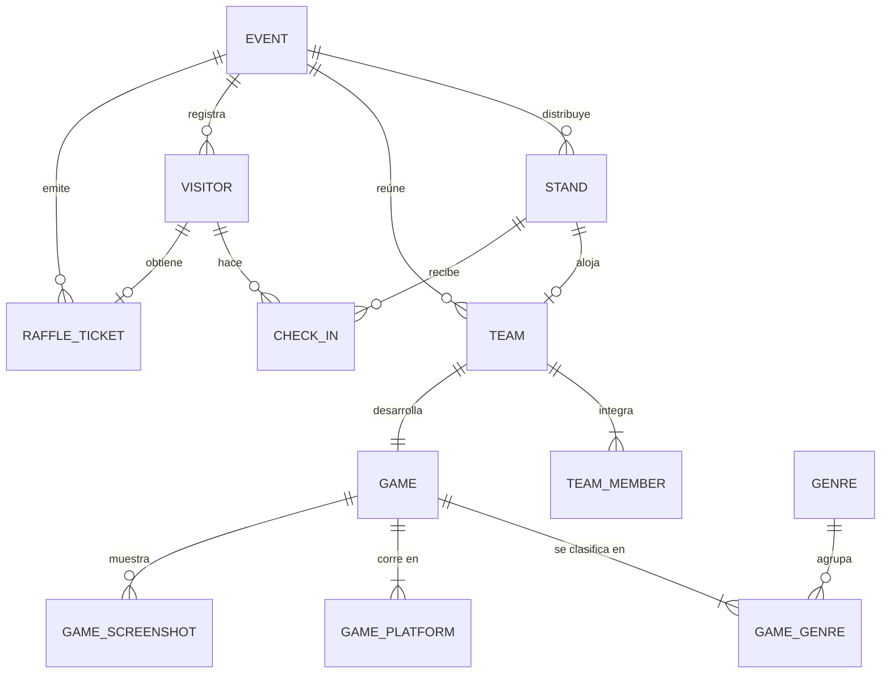
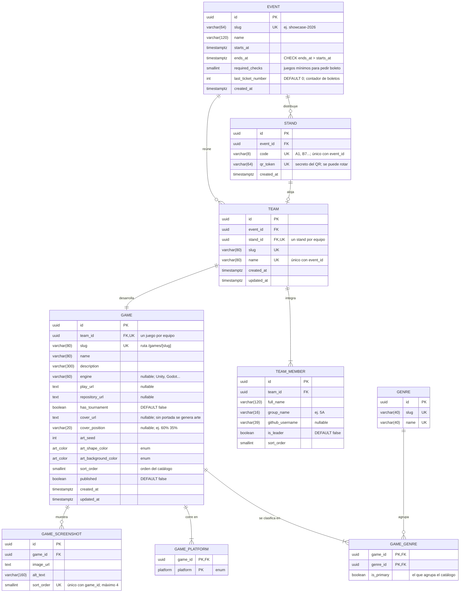
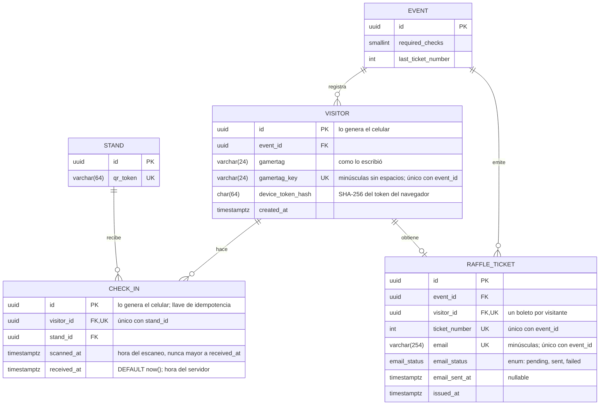

# Modelo de datos (diagrama ER)

Propuesta del modelo relacional en PostgreSQL para los tres requerimientos de la plataforma:

1. **Administrar y mostrar los videojuegos** (equipos, integrantes, géneros, plataformas y capturas).
2. **Check-ins sin login**: el visitante escanea el QR del stand, se identifica sólo con su
   gamertag, marca cada juego que probó y al final recibe por correo su número de rifa.
3. **Afluencia en tiempo real** de cada stand, aunque el internet del recinto falle.

Es la base para escribir `src/shared/lib/prisma/contract.prisma`. Todavía no hay modelos en el
contrato; los datos del sitio siguen siendo mock (ver [`data-sources.md`](./data-sources.md)).

## Reglas de negocio

| # | Regla | Cómo se cumple |
| --- | --- | --- |
| 1 | Un equipo tiene varios integrantes. | Uno a muchos: `team_member.team_id`. |
| 2 | Un equipo tiene un solo juego. | `game.team_id` es `UNIQUE` y `NOT NULL`. |
| 2 | Un equipo tiene un solo stand. | `team.stand_id` es `UNIQUE` y `NOT NULL`. Un stand puede quedar libre. |
| 3 y 4 | Un visitante visita varios stands y un stand recibe muchos visitantes. | Relación muchos a muchos resuelta con la tabla intermedia `CHECK_IN`. |
| - | Un visitante marca cada juego una sola vez. | `UNIQUE (visitor_id, stand_id)` en `check_in`. |
| - | El gamertag no se repite dentro de un evento. | `UNIQUE (event_id, gamertag_key)` en `visitor`. |
| - | Un boleto de rifa por visitante y por correo. | `UNIQUE (visitor_id)` y `UNIQUE (event_id, email)` en `raffle_ticket`. |

`EVENT` no viene en las reglas originales: agrupa stands, equipos, visitantes y boletos por
edición, así el sistema sirve el próximo año sin borrar datos y los números de rifa empiezan
en 1 en cada evento.

## Vista general

Sólo entidades y relaciones. El detalle de columnas está en las dos secciones siguientes.



Cómo leer la cardinalidad: `||` exactamente uno, `o|` cero o uno, `|{` uno o muchos y
`o{` cero o muchos. Por ejemplo, `STAND ||--o| TEAM` dice que cada equipo tiene exactamente
un stand y que un stand tiene cero o un equipo (los stands sin asignar quedan libres).

## Convenciones

- Tablas y columnas en inglés y `snake_case`; en el diagrama las entidades van en mayúsculas.
- Todas las llaves primarias son `uuid` (`@default(uuid())` en Prisma 8), salvo `visitor.id` y
  `check_in.id`, que **genera el celular** (`crypto.randomUUID()`) para poder trabajar sin
  internet (ver "Internet intermitente").
- Todas las columnas son `NOT NULL`, salvo las marcadas como `nullable` en su comentario.
- Las fechas son `timestamptz` (en UTC); `created_at` y `updated_at` llevan `DEFAULT now()`.
- `UK` marca columnas únicas. Cuando la unicidad es compuesta, el comentario lo dice
  (por ejemplo, `code` es único junto con `event_id`).
- Los enums (`art_color`, `platform`, `email_status`) son `text` con un `CHECK` de valores
  permitidos: así los genera Prisma 8 (`enum` con `@@type("pg/text@1")`).
- Las relaciones muchos a muchos usan tablas intermedias explícitas (`GAME_GENRE`,
  `GAME_PLATFORM` y `CHECK_IN`); Prisma 8 no acepta muchos a muchos implícitos.
- Toda llave foránea lleva índice (PostgreSQL no lo crea solo); ver "Índices".

## Catálogo: evento, stands, equipos y juegos



Notas:

- **Stands**: sólo se guardan los stands de equipo (pasillos A y B). Sus códigos deben existir
  en `src/features/floor-plan/lib/plan-layouts.ts`. Los stands informativos C1-C4 y las zonas
  siguen siendo contenido fijo del croquis.
- **Géneros**: el registro de videojuego (`.github/ISSUE_TEMPLATE/04-game-submission.yml`)
  permite varios géneros, por eso es muchos a muchos. `is_primary` marca el que usa el
  catálogo para agruparlo; un índice único parcial (`WHERE is_primary`) impide que un juego
  tenga dos géneros principales.
- **Plataformas**: lista fija del registro, como enum `platform`
  (`web`, `windows`, `macos`, `linux`, `android`, `ios`, `console`).
- **Arte generado**: enum `art_color` (`acid`, `black`, `white`, `panel`, `light`), igual que
  `ArtColor` en `src/features/games/lib/types.ts`.
- **Integrantes**: se calcula `count(*)` de `team_member`; no se guarda el número.

## Participación de visitantes: check-ins y rifa



### Flujo sin login

1. El QR del stand abre `/check-in/<qr_token>`. `qr_token` es aleatorio (no el código `A1`)
   para que nadie marque stands escribiendo la URL; si una foto del QR circula, se rota.
2. La primera vez el visitante escribe **sólo su gamertag**. El navegador genera `visitor.id`
   y un token secreto que guarda en `localStorage`; el servidor sólo guarda su hash
   (`device_token_hash`). No es un login: el visitante no ve ni escribe nada más, pero evita
   que otra persona pida el boleto con un gamertag ajeno.
3. Cada escaneo crea un `check_in`. Si el visitante escanea dos veces el mismo stand, la
   restricción `UNIQUE (visitor_id, stand_id)` lo ignora.
4. Cuando tiene al menos `event.required_checks` check-ins, escribe su correo y recibe el
   boleto. El número se asigna en una transacción:

   ```sql
   BEGIN;
   UPDATE event SET last_ticket_number = last_ticket_number + 1
   WHERE id = $1
   RETURNING last_ticket_number;            -- bloquea la fila: no hay números repetidos
   INSERT INTO raffle_ticket (event_id, visitor_id, ticket_number, email, email_status)
   VALUES ($1, $2, $3, lower($4), 'pending');
   COMMIT;
   ```

   Usa `UPDATE ... RETURNING` y no `SELECT ... FOR UPDATE`: el `UPDATE` toma un bloqueo que no
   choca con los `INSERT` que apuntan a `event` (visitantes y boletos), así no hay esperas ni
   deadlocks. En Prisma 8 va dentro de `db.transaction(...)`.

5. El correo se envía después del `COMMIT`. `email_status` y `email_sent_at` permiten
   reintentar los que fallen sin volver a generar el boleto.

`UNIQUE (event_id, email)` impide que una persona junte varios boletos creando varios
gamertags con el mismo correo.

### Afluencia por stand

La afluencia no necesita otra tabla: se calcula con los check-ins recientes. Como el visitante
marca el juego al terminar la demo, el dato es "personas que jugaron en los últimos 15 minutos".

```sql
CREATE VIEW stand_traffic AS
SELECT s.id AS stand_id,
       s.code,
       count(c.id) FILTER (WHERE c.scanned_at > now() - interval '15 minutes') AS recent_check_ins,
       count(c.id) AS total_check_ins
FROM stand s
LEFT JOIN check_in c ON c.stand_id = s.id
GROUP BY s.id, s.code;
```

El croquis puede consultarla cada 30 segundos con TanStack Query (`refetchInterval`) a través
de un Route Handler. Si después se necesita la ocupación exacta (personas dentro del stand en
este momento), se agrega una tabla de reportes que llene el equipo del stand.

## Internet intermitente

El modelo está pensado para que los check-ins no se pierdan cuando se va el internet:

- **Identificadores generados en el celular**: `visitor.id` y `check_in.id` son UUID creados
  con `crypto.randomUUID()`. El celular guarda los check-ins en una cola local (IndexedDB) y
  los reenvía al volver la conexión; el servidor inserta con `ON CONFLICT (id) DO NOTHING`,
  así un reintento nunca duplica datos.
- **Dos horas por check-in**: `scanned_at` es la hora en que se escaneó y `received_at` la hora
  en que llegó al servidor. El servidor guarda `scanned_at = LEAST(hora del celular, now())`
  (con `CHECK (scanned_at <= received_at)`), así un reloj adelantado no altera la afluencia y
  los check-ins que llegan tarde cuentan en su hora real.
- **Gamertag repetido sin conexión**: dos personas pueden elegir el mismo gamertag mientras
  están offline. Al sincronizar, el segundo recibe el error de `UNIQUE` y la app le pide otro.
- **Infraestructura (pendiente de decidir)**: el modelo sirve igual si la base vive en la nube
  y los celulares encolan offline, o si se monta un servidor local en la red del recinto que
  replica a la nube cuando hay internet. Los UUID evitan choques de llaves en ambos casos.

Volumen esperado: unos cientos o pocos miles de visitantes y ~18 stands, es decir, decenas de
miles de check-ins por evento. No hace falta particionar ni réplicas de lectura.

## Índices

Además de las llaves primarias y las restricciones `UNIQUE` (que ya crean su índice):

| Tabla | Índice | Para qué |
| --- | --- | --- |
| `stand` | `UNIQUE (event_id, code)` | Buscar un stand por su código en el croquis. |
| `team` | `UNIQUE (event_id, name)` | Nombres de equipo sin repetir por evento. |
| `team_member` | `(team_id)` | Integrantes de un equipo. |
| `game_genre` | `(genre_id)` | Juegos de un género (la PK empieza por `game_id`). |
| `game_genre` | `UNIQUE (game_id) WHERE is_primary` | Un solo género principal por juego. |
| `game_screenshot` | `UNIQUE (game_id, sort_order)` | Galería ordenada. |
| `visitor` | `UNIQUE (event_id, gamertag_key)` | Buscar al visitante por gamertag. |
| `check_in` | `UNIQUE (visitor_id, stand_id)` | Un check por juego; también lista los del visitante. |
| `check_in` | `(stand_id, scanned_at)` | Afluencia reciente por stand. |
| `raffle_ticket` | `UNIQUE (event_id, ticket_number)` | Buscar al ganador en el sorteo. |
| `raffle_ticket` | `UNIQUE (event_id, email)` | Un boleto por correo. |

## Reglas que valida la aplicación

PostgreSQL no puede expresar estas reglas con llaves foráneas simples; se validan en las
Server Actions (`lib/<feature>-actions.ts`):

- Todo equipo publicado tiene su juego y al menos un integrante.
- Cada juego tiene al menos un género principal (el índice parcial evita que tenga dos) y
  como máximo 4 capturas.
- El visitante y el stand de un check-in pertenecen al mismo evento.
- Sólo se aceptan check-ins entre `event.starts_at` y `event.ends_at`.
- El boleto se emite si el visitante tiene al menos `event.required_checks` check-ins.

## Relación con el tipo `Game` actual

El resto de la app no cambia: `lib/games-queries.ts` arma el tipo `Game`
(`src/features/games/lib/types.ts`) con estas columnas.

| Campo de `Game` | Origen |
| --- | --- |
| `slug`, `name`, `description`, `hasTournament` | `game` |
| `genre` | `genre.name` de `game_genre` con `is_primary = true` |
| `team` | `team.name` |
| `members` | `count(*)` de `team_member` |
| `stand` | `stand.code` del equipo |
| `image` | `game.cover_url` y `game.cover_position` (`null` si no hay portada) |
| `art` | `game.art_seed`, `game.art_shape_color` y `game.art_background_color` |

## Privacidad

- El gamertag es un seudónimo; el único dato personal del visitante es el correo y sólo se pide
  al final, para enviar el boleto.
- El formulario del correo debe mostrar el aviso de privacidad y decir para qué se usa.
- Después del último sorteo se pueden borrar los correos (o toda la tabla `raffle_ticket` y
  `visitor`) y conservar sólo los conteos de `check_in` para estadísticas.

## Fuera de este modelo (por decidir)

- **Organizadores**: quién entra a administrar juegos y cómo se autentica. Se agrega su tabla
  cuando se elija la estrategia de autenticación.
- **Sorteos y premios**: hoy los ganadores se anuncian en el main stage. Si se quiere registrar
  quién ganó qué, se agregan `RAFFLE_DRAW` y `PRIZE` relacionadas con `RAFFLE_TICKET`.
- **Torneos**: `has_tournament` sólo marca si el juego tiene torneo; inscripciones y resultados
  quedarían en tablas propias.
