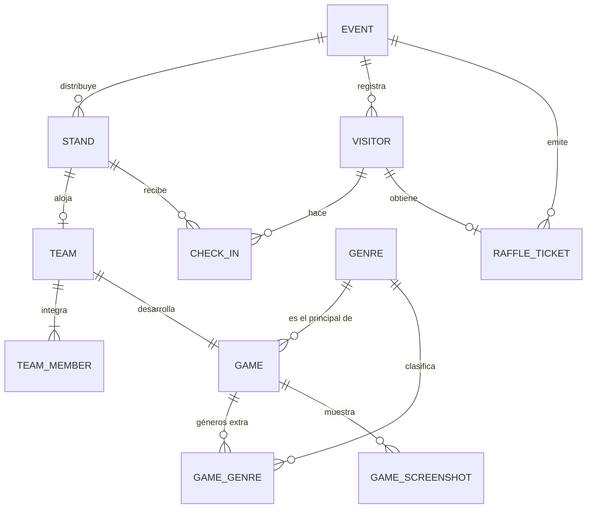
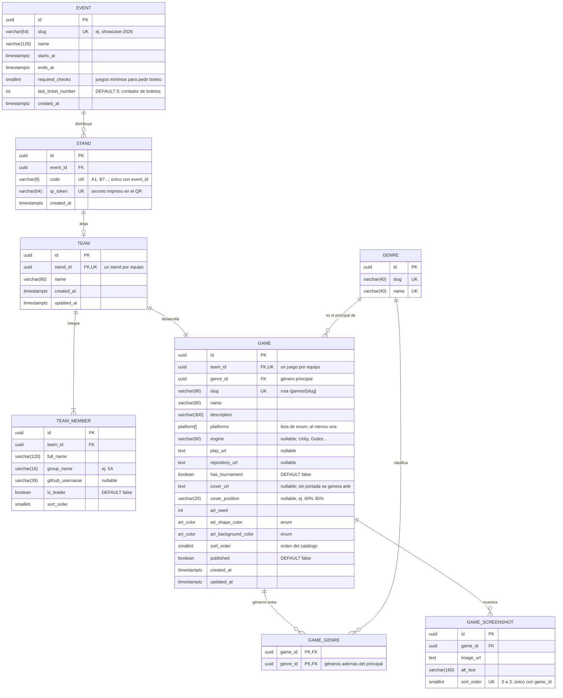
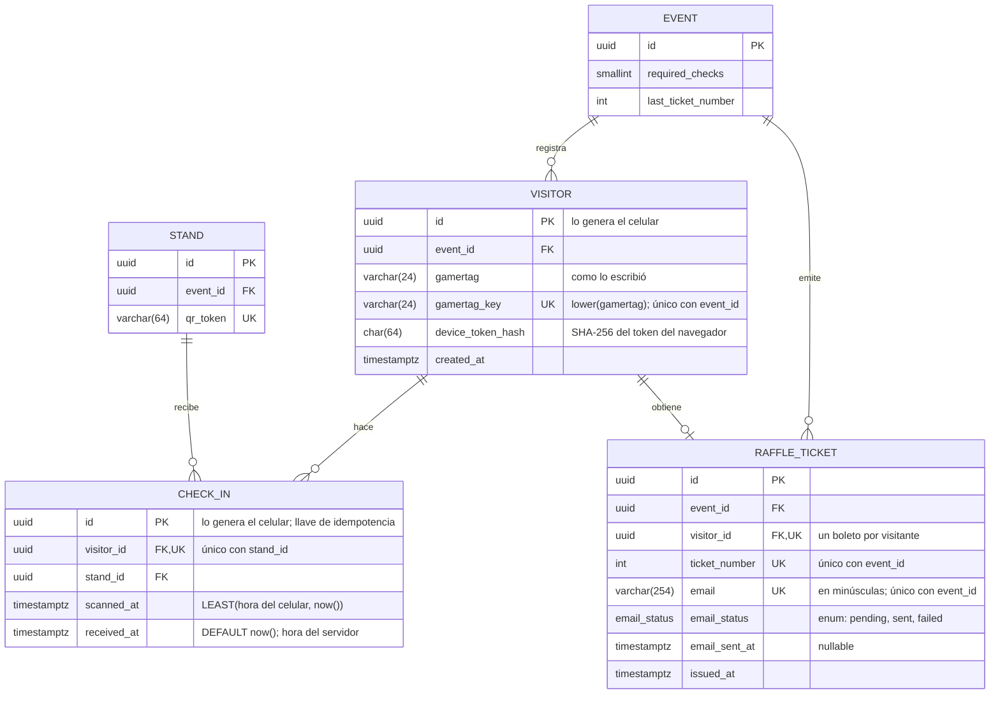

# Modelo de datos (diagrama ER)

Propuesta del modelo relacional en PostgreSQL para los tres requerimientos de la plataforma:

1. **Administrar y mostrar los videojuegos** (equipos, integrantes, géneros, plataformas y capturas).
2. **Check-ins sin login**: el visitante escanea el QR del stand, se identifica sólo con su
   gamertag, marca cada juego que probó y al final recibe por correo su número de rifa.
3. **Afluencia en tiempo real** de cada stand, aunque el internet del recinto falle.

Es la base para escribir `src/shared/lib/prisma/contract.prisma`. Todavía no hay modelos en el
contrato; los datos del sitio siguen siendo mock (ver [`data-sources.md`](./data-sources.md)).

## Reglas de negocio

| # | Regla | Cómo se cumple |
| --- | --- | --- |
| 1 | Un equipo tiene varios integrantes. | Uno a muchos: `team_member.team_id`. |
| 2 | Un equipo tiene un solo juego. | `game.team_id` es `UNIQUE` y `NOT NULL`. |
| 2 | Un equipo tiene un solo stand. | `team.stand_id` es `UNIQUE` y `NOT NULL`. Un stand puede quedar libre. |
| 3 y 4 | Un visitante visita varios stands y un stand recibe muchos visitantes. | Relación muchos a muchos resuelta con la tabla intermedia `CHECK_IN`. |
| - | Un visitante marca cada juego una sola vez. | `UNIQUE (visitor_id, stand_id)` en `check_in`. |
| - | El gamertag no se repite dentro de un evento. | `UNIQUE (event_id, gamertag_key)` en `visitor`. |
| - | Un boleto de rifa por visitante y por correo. | `UNIQUE (visitor_id)` y `UNIQUE (event_id, email)` en `raffle_ticket`. |

`EVENT` no viene en las reglas originales: agrupa stands, visitantes y boletos por edición, así
el sistema sirve el próximo año sin borrar datos y los números de rifa empiezan en 1 en cada
evento. Un equipo pertenece al evento de su stand.

## Vista general

Sólo entidades y relaciones. El detalle de columnas está en las dos secciones siguientes.



Cómo leer la cardinalidad: `||` exactamente uno, `o|` cero o uno, `|{` uno o muchos y
`o{` cero o muchos. Por ejemplo, `STAND ||--o| TEAM` dice que cada equipo tiene exactamente
un stand y que un stand tiene cero o un equipo (los stands sin asignar quedan libres).

El diagrama muestra las reglas del negocio. La base de datos garantiza el lado "como máximo"
(un juego por equipo, un stand por equipo); el lado "al menos uno" de `TEAM ||--|| GAME` y
`TEAM ||--|{ TEAM_MEMBER` lo valida la aplicación al publicar (ver "Reglas que valida la
aplicación").

## Convenciones

- Tablas y columnas en inglés y `snake_case`; en el diagrama las entidades van en mayúsculas.
- Todas las llaves primarias son `uuid` (`@default(uuid())` en Prisma 8), salvo `visitor.id` y
  `check_in.id`, que **genera el celular** (`crypto.randomUUID()`) para poder trabajar sin
  internet (ver "Internet intermitente").
- Todas las columnas son `NOT NULL`, salvo las marcadas como `nullable` en su comentario.
- Las fechas son `timestamptz` (en UTC); `created_at` y `updated_at` llevan `DEFAULT now()`.
- `UK` marca columnas únicas. Cuando la unicidad es compuesta, el comentario lo dice
  (por ejemplo, `code` es único junto con `event_id`).
- Los enums (`art_color`, `platform`, `email_status`) son `text` con un `CHECK` de valores
  permitidos: así los genera Prisma 8 (`enum` con `@@type("pg/text@1")`).
- Las relaciones muchos a muchos usan tablas intermedias explícitas (`GAME_GENRE` y
  `CHECK_IN`); Prisma 8 no acepta muchos a muchos implícitos.
- Las reglas simples viven en la base como `CHECK` (`@@check` en Prisma 8); ver "Restricciones".

## Catálogo: evento, stands, equipos y juegos



Notas:

- **Stands**: sólo se guardan los stands de equipo (pasillos A y B). Sus códigos deben existir
  en `src/features/floor-plan/lib/plan-layouts.ts`. Los stands informativos C1-C4 y las zonas
  siguen siendo contenido fijo del croquis.
- **Equipos**: no guardan `event_id`; su evento es el del stand. Así no puede haber un equipo
  de 2026 en un stand de 2027.
- **Géneros**: el registro de videojuego (`.github/ISSUE_TEMPLATE/04-game-submission.yml`)
  permite varios. `game.genre_id` es el principal (el que agrupa el catálogo) y, como es
  `NOT NULL`, todo juego tiene exactamente uno; `GAME_GENRE` guarda los demás.
- **Plataformas**: lista fija del registro, guardada como arreglo del enum `platform`
  (`web`, `windows`, `macos`, `linux`, `android`, `ios`, `console`). No necesita tabla propia.
- **Arte generado**: enum `art_color` (`acid`, `black`, `white`, `panel`, `light`), igual que
  `ArtColor` en `src/features/games/lib/types.ts`.
- **Integrantes**: se calcula `count(*)` de `team_member`; no se guarda el número.

## Participación de visitantes: check-ins y rifa



### Flujo sin login

1. El QR del stand abre `/check-in/<qr_token>`. `qr_token` es aleatorio (no el código `A1`)
   para que nadie marque stands escribiendo la URL. No se cambia durante el evento: los
   check-ins que esperan en la cola del celular lo llevan.
2. La primera vez el visitante escribe **sólo su gamertag**. El navegador genera `visitor.id`
   y un token secreto que guarda en `localStorage`; el servidor sólo guarda su hash
   (`device_token_hash`) y lo verifica en cada envío. El visitante no ve ni escribe nada más,
   pero nadie puede marcar juegos ni pedir el boleto con un gamertag ajeno.
3. Cada escaneo guarda en el celular `{ id, qr_token, scanned_at }` y lo envía a un solo
   endpoint de sincronización junto con el visitante. El servidor, en una transacción:
   - inserta el visitante si no existe (`ON CONFLICT (id) DO NOTHING`) y verifica el token;
   - convierte cada `qr_token` en su `stand_id` (un `qr_token` válido es lo que permite crear
     al visitante, así no se registran gamertags sin haber pasado por un stand);
   - inserta los check-ins con `INSERT ... ON CONFLICT DO NOTHING` **sin columna**, que ignora
     tanto un reintento (mismo `id`) como un segundo escaneo del mismo stand (otro `id`, mismo
     `visitor_id` y `stand_id`). Con `ON CONFLICT (id)` el segundo caso lanzaría un error y
     abortaría todo el lote. Va con SQL crudo (`db.raw.sql`), porque el `upsert` del ORM
     sólo cubre una restricción.
4. **Gamertag ocupado**: si el visitante está en línea, se le avisa al escribirlo. Si se
   registró sin conexión y al sincronizar el gamertag ya existe, el servidor le agrega un
   sufijo (`neo-2`), lo devuelve y la app lo muestra. Nunca se descartan sus check-ins.
5. **Boleto**: antes de pedirlo, la app envía los check-ins pendientes. Si el visitante tiene
   al menos `event.required_checks`, escribe su correo y el número se asigna en una
   transacción:

   ```sql
   BEGIN;
   UPDATE event SET last_ticket_number = last_ticket_number + 1
   WHERE id = $1
   RETURNING last_ticket_number;            -- bloquea la fila: no hay números repetidos
   INSERT INTO raffle_ticket (event_id, visitor_id, ticket_number, email, email_status)
   VALUES ($1, $2, $3, lower($4), 'pending');
   COMMIT;
   ```

   - Usa `UPDATE ... RETURNING` y no `SELECT ... FOR UPDATE`: el `UPDATE` toma un bloqueo que
     no choca con los `INSERT` que apuntan a `event` (visitantes y boletos), así no hay
     esperas ni deadlocks. En Prisma 8 va dentro de `db.transaction(...)`.
   - Si el `INSERT` falla (por ejemplo, el visitante ya tenía boleto porque se reintentó la
     petición), la transacción se revierte, el contador no avanza y se devuelve el boleto
     que ya existía.
   - El número **también se muestra en pantalla**. El correo se envía después del `COMMIT`;
     `email_status` y `email_sent_at` permiten reintentar los que fallen, y si el correo tenía
     un error el visitante lo corrige y se reenvía con el mismo número.
6. **Límite de peticiones** por visitante (token), no por IP: todo el recinto puede salir a
   internet con la misma IP.

`UNIQUE (event_id, email)` impide que una persona junte varios boletos creando varios
gamertags con el mismo correo.

### Afluencia por stand

La afluencia no necesita otra tabla: se calcula con los check-ins recientes del evento.

```sql
SELECT s.code, count(c.id) AS recent_check_ins
FROM stand s
LEFT JOIN check_in c
  ON c.stand_id = s.id
 AND c.scanned_at > now() - interval '15 minutes'
WHERE s.event_id = $1
GROUP BY s.code;
```

- Usa el índice `(stand_id, scanned_at)` y sólo lee los últimos 15 minutos.
- Va en una función de `lib/*-queries.ts` con `"use cache"` y un `cacheLife` de unos 30
  segundos, así todos los visitantes comparten una sola consulta. El croquis la pide a un
  Route Handler y la refresca con `refetchInterval` de TanStack Query.
- Qué mide: como el visitante marca el juego al terminar la demo y cada juego cuenta una sola
  vez por visitante, es "personas que probaron el juego por primera vez en los últimos 15
  minutos". Si se necesita la ocupación exacta (personas en el stand en este momento), se
  agrega una tabla de reportes que llene el equipo del stand.

## Internet intermitente

El modelo está pensado para que los check-ins no se pierdan cuando se va el internet:

- **Identificadores generados en el celular**: `visitor.id` y `check_in.id` son UUID creados
  con `crypto.randomUUID()`. El celular guarda los check-ins en una cola local (IndexedDB) y
  los reenvía al volver la conexión; `ON CONFLICT DO NOTHING` hace que reenviar sea seguro.
- **Página disponible sin conexión**: el primer escaneo necesita internet para cargar la
  página; después, un service worker la guarda para que los siguientes escaneos funcionen
  offline.
- **Dos horas por check-in**: `scanned_at` es la hora en que se escaneó y `received_at` la hora
  en que llegó al servidor. El `INSERT` calcula `scanned_at = LEAST($hora_del_celular, now())`
  en SQL (no en Node, cuyo reloj puede ir adelantado respecto a la base), así un celular
  adelantado no altera la afluencia y los check-ins que llegan tarde cuentan en su hora real.
  Para celulares atrasados, el lote puede incluir la hora del celular al enviarlo y el
  servidor corrige la diferencia.
- **Envíos tardíos**: se aceptan sincronizaciones hasta 24 horas después de `ends_at`; lo que
  se valida es que `scanned_at` caiga dentro del evento.
- **Infraestructura (pendiente de decidir)**: debe haber **un solo servidor que escriba**.
  Lo más simple es la base en la nube y los celulares con su cola offline. Si se monta un
  servidor local en la red del recinto, durante el evento ese es el único que escribe y
  después se copia a la nube. Dos servidores escribiendo a la vez chocarían en gamertags,
  check-ins y números de boleto (los UUID sólo evitan choques de llaves primarias).

Volumen esperado: unos cientos o pocos miles de visitantes y ~18 stands, es decir, decenas de
miles de check-ins por evento. No hace falta particionar ni réplicas de lectura.

## Restricciones

### Índices

Además de las llaves primarias y las restricciones `UNIQUE` (que ya crean su índice):

| Tabla | Índice | Para qué |
| --- | --- | --- |
| `stand` | `UNIQUE (event_id, code)` | Buscar un stand por su código en el croquis. |
| `stand` | `UNIQUE (qr_token)` | Resolver el QR escaneado. |
| `team` | `UNIQUE (stand_id)` | Un stand por equipo; también sirve a la llave foránea. |
| `team_member` | `(team_id)` | Integrantes de un equipo. |
| `game` | `UNIQUE (team_id)` y `(genre_id)` | Juego de un equipo; juegos de un género. |
| `game_genre` | `(genre_id)` | Juegos con un género extra (la PK empieza por `game_id`). |
| `game_screenshot` | `UNIQUE (game_id, sort_order)` | Galería ordenada. |
| `visitor` | `UNIQUE (event_id, gamertag_key)` | Buscar al visitante por gamertag. |
| `check_in` | `UNIQUE (visitor_id, stand_id)` | Un check por juego; también lista los del visitante. |
| `check_in` | `(stand_id, scanned_at)` | Afluencia reciente por stand. |
| `raffle_ticket` | `UNIQUE (visitor_id)` | Un boleto por visitante. |
| `raffle_ticket` | `UNIQUE (event_id, ticket_number)` | Buscar al ganador en el sorteo. |
| `raffle_ticket` | `UNIQUE (event_id, email)` | Un boleto por correo. |

### CHECK

| Tabla | Restricción |
| --- | --- |
| `event` | `ends_at > starts_at` y `required_checks >= 1` |
| `game` | `cardinality(platforms) >= 1` |
| `game_screenshot` | `sort_order BETWEEN 0 AND 3` (máximo 4 capturas) |
| `visitor` | `gamertag_key = lower(gamertag)` y `gamertag_key ~ '^[a-z0-9_.-]{3,24}$'` |
| `check_in` | `scanned_at <= received_at` |
| `raffle_ticket` | `email = lower(email)` |

El gamertag sólo acepta letras sin acento, números, `_`, `.` y `-` (de 3 a 24). Así no hay dos
gamertags que se vean iguales con letras de otros alfabetos.

### Borrado (`onDelete`)

Decláralo explícito en cada relación del contrato:

- `Cascade`: `team` borra sus `team_member` y su `game`; `game` borra sus `game_genre` y
  `game_screenshot`.
- `Restrict` (no deja borrar si hay registros que dependen): todo lo demás. Por ejemplo, un
  stand con check-ins o un género con juegos no se pueden borrar.

## Reglas que valida la aplicación

PostgreSQL no puede expresar estas reglas con restricciones simples; se validan en las
Server Actions (`lib/<feature>-actions.ts`) y en el endpoint de sincronización:

- Todo equipo publicado tiene su juego y al menos un integrante.
- Los géneros extra de un juego no repiten su género principal.
- El visitante y el stand de un check-in, y el visitante y su boleto, son del mismo evento.
- Un check-in es válido si `scanned_at` cae entre `event.starts_at` y `event.ends_at`.
- El boleto se emite si el visitante tiene al menos `event.required_checks` check-ins.

## Relación con el tipo `Game` actual

El resto de la app no cambia: `lib/games-queries.ts` arma el tipo `Game`
(`src/features/games/lib/types.ts`) con estas columnas.

| Campo de `Game` | Origen |
| --- | --- |
| `slug`, `name`, `description`, `hasTournament` | `game` |
| `genre` | `genre.name` del género principal (`game.genre_id`) |
| `team` | `team.name` |
| `members` | `count(*)` de `team_member` |
| `stand` | `stand.code` del equipo |
| `image` | `game.cover_url` y `game.cover_position` (`null` si no hay portada) |
| `art` | `game.art_seed`, `game.art_shape_color` y `game.art_background_color` |

## Privacidad y seguridad

- El gamertag es un seudónimo; el único dato personal es el correo, que sólo se pide al final
  y sólo vive en `raffle_ticket`.
- El formulario del correo debe mostrar el aviso de privacidad y decir para qué se usa.
- Después del último sorteo se borran las filas de `raffle_ticket` (ninguna tabla depende de
  ella). `visitor` y `check_in` no tienen datos personales y se conservan para estadísticas.
- La aplicación se conecta con un usuario de PostgreSQL sin permisos para cambiar tablas; las
  migraciones usan otro usuario.

## Fuera de este modelo (por decidir)

- **Recuperar el token**: si el visitante cambia de navegador o borra sus datos, pierde el
  token. La propuesta es que el staff del módulo de Información asocie su gamertag a un token
  nuevo mientras no tenga boleto. Dejar que cualquiera lo haga solo (sin staff) quita
  fricción, pero permitiría quedarse con el gamertag de otra persona antes de que pida su
  boleto.
- **Organizadores**: quién entra a administrar juegos y cómo se autentica. Se agrega su tabla
  cuando se elija la estrategia de autenticación.
- **Sorteos y premios**: hoy los ganadores se anuncian en el main stage. Si se quiere registrar
  quién ganó qué, se agregan `RAFFLE_DRAW` y `PRIZE` relacionadas con `RAFFLE_TICKET`.
- **Torneos**: `has_tournament` sólo marca si el juego tiene torneo; inscripciones y resultados
  quedarían en tablas propias.
